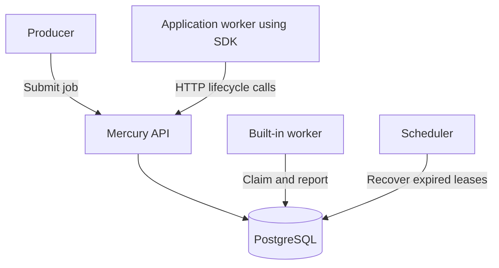

<h1 align="center">Mercury</h1>
<p align="center">
PostgreSQL-based Distributed job-execution system in Go
</p>

## Contents

- [Highlights](#highlights)
- [Architecture](#architecture)
- [Build and test](#build-and-test)
- [What this project demonstrates](#what-this-project-demonstrates)

## Highlights

- Independent API, worker, scheduler, and all-in-one runtime roles
- Atomic job claiming with PostgreSQL row locks and `SKIP LOCKED`
- Leases, fencing tokens, and heartbeats for worker ownership
- Delayed retries, bounded execution, and expired-lease recovery
- Idempotent job submission
- Authenticated remote-worker HTTP API and public Go SDK
- Configurable external task types without application-specific engine changes
- Docker Compose and database migrations

## Architecture



PostgreSQL stores job state and coordinates ownership. Workers execute handlers; the scheduler recovers expired leases.

Application-owned workers use the public SDK for polling, heartbeats, and lifecycle reporting. [Iris](https://github.com/xTwo56/iris) uses this interface for webhook delivery.

Execution is at-least-once. Handlers must tolerate repeated execution; fencing protects job-state updates, not external side effects.

## Build and test

```sh
go build ./...
go test ./...
go test -race ./...
```

PostgreSQL integration tests require a disposable database configured through `MERCURY_TEST_DATABASE_URL`; they may skip when it is unset.

## What this project demonstrates

- Concurrent work distribution through transactional database coordination
- Recovery from worker failure without losing persisted jobs
- Separation of generic execution infrastructure from application handlers
